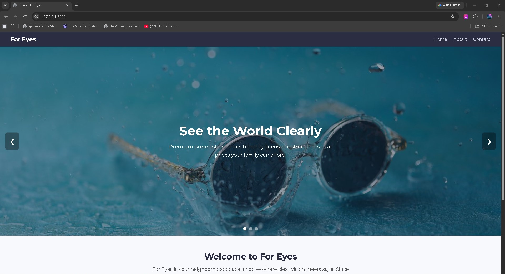
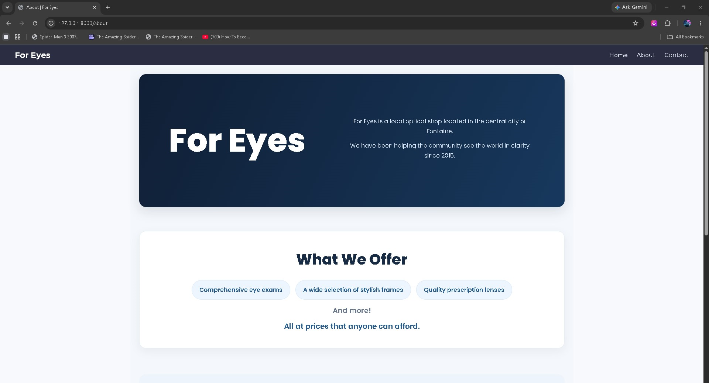
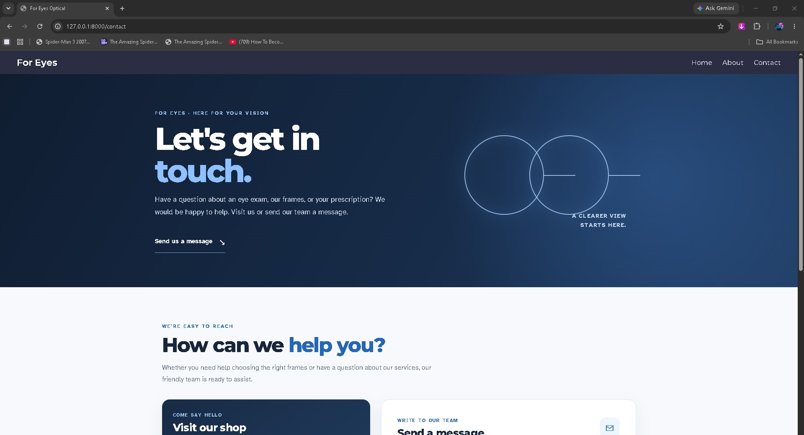

# For Eyes — Multi-Page Laravel Web App

A Laravel web application for **For Eyes**, a local optical shop offering eye exams, stylish frames, and prescription lenses.

## 👥 Group Information

- **Group Name:** [ForEyes]
- **Section:** AIGO1
- **Members:**
  | Member | Name | Role | Branch |
  |--------|------|------|--------|
  | Member 1 (Group Leader) | Kyle Perry A. Tiempo | Project Setup, Layout & Home Page | `dev-member1-Tiempo` |
  | Member 2 | Herly Heart P. Galola | About Page | `dev-member2-Galola` |
  | Member 3 | Vincent Earl Bullicer | Contact Page | `dev-member3-Bullicer` |

## 🕶️ App Theme

For Eyes is your neighborhood optical shop, where clear vision meets style. Since 2015, we've helped over 5,000 customers find the perfect eyewear, from free eye checkups to the latest frame trends.

## 📄 Pages & Features

### Home Page (Member 1)
- Hero section with an **image slider/carousel** (autoplay, arrows, and dot navigation)
- Theme description and services preview cards
- Shared navigation bar and footer



### About Page (Member 2)
- Shop background and "What We Offer" section
- **Read More / Read Less toggle** for staff bios
- **Animated number counters** (5,000+ customers, 10+ years, 150+ frames, 3 branches)
- Scroll-reveal animations on team cards



### Contact Page (Member 3)
- Contact form (name, email, subject, message)
- **Client-side validation** with error messages (empty fields, invalid email)
- Success message on valid submission
- Shop contact details (address, phone, email, hours)



## 🛠️ Tech Stack

- Laravel (PHP framework)
- Blade templating (`@extends`, `@section`, `@yield`, `@stack`)
- HTML, CSS, JavaScript (one CSS + one JS file per page, loaded via `asset()`)
- Git & GitHub (feature branches + pull requests)

## ▶️ How to Run the Project

### Prerequisites
- PHP 8.2 or higher
- Composer
- Git

### Steps

1. Clone the repository:
   ```bash
   git clone https://github.com/[YOUR-USERNAME]/Lara-Proj-AIGO1-Tiempo-Galola-Bullicer.git
   cd Lara-Proj-AIGO1-Tiempo-Galola-Bullicer
   ```
2. Install PHP dependencies:
   ```bash
   composer install
   ```
3. Set up the environment file and app key:
   ```bash
   cp .env.example .env        # Windows: copy .env.example .env
   php artisan key:generate
   ```
4. Set up the database (for sessions):
   ```bash
   php artisan migrate
   ```
5. Start the development server:
   ```bash
   php artisan serve
   ```
6. Open **http://127.0.0.1:8000** in your browser.

## 🔀 Git Workflow

- One repository, one branch per member (`dev-member1-Tiempo`, `dev-member2-Galola`, `dev-member3-Bullicer`)
- No direct pushes to `main` — all changes merged via Pull Request
- Each member made 5+ meaningful commits in their own branch
